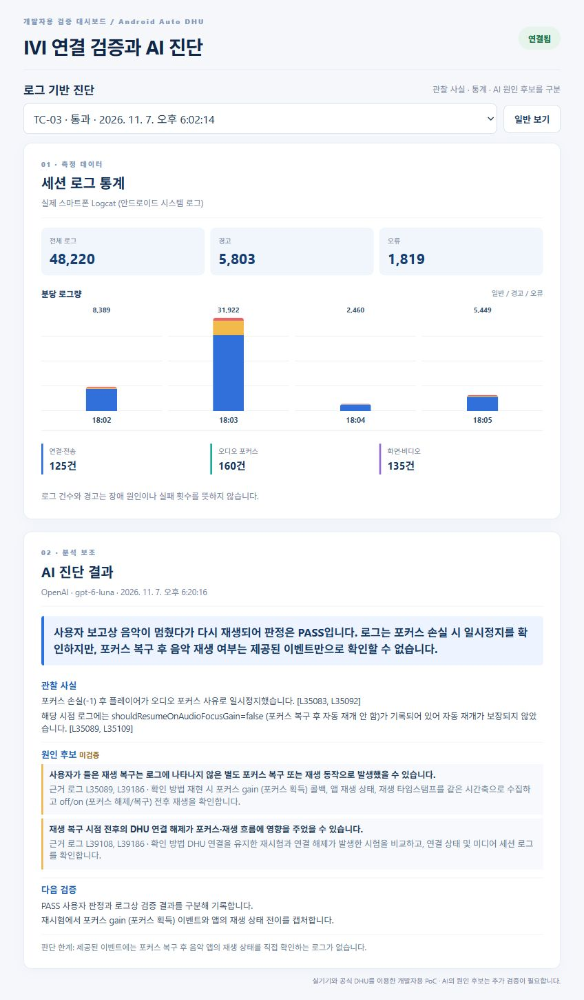
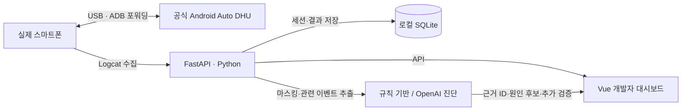

# IVI 폰 연결 검증 및 AI 진단 PoC

**AI-Assisted IVI Phone Connectivity Validation & Diagnostics**

실제 삼성 스마트폰과 공식 Android Auto Desktop Head Unit(DHU)을 연결해 테스트를 수행하고, 수집한 Logcat을 분석하는 **개발자용 검증 도구**입니다. Python 백엔드가 ADB 상태와 테스트 세션을 관리하고, Vue 대시보드가 로그 통계와 AI 진단 근거를 보여줍니다.

> 핵심 원칙: 사용자가 확인한 결과, Logcat에서 관찰한 이벤트, AI가 제안한 원인 후보를 구분합니다.

<p align="center"></p>

<p align="center"><sub>TC-03 실제 세션의 로그 통계와 저장된 OpenAI 진단 결과. 발표용 보기에서 캡처했습니다.</sub></p>

## 실제 검증 결과

2026년 11월 7일 기준, **6개 테스트 시나리오**를 정의했습니다. 대시보드에는 반복 생성한 세션까지 포함해 **8개 세션 중 통과 4개, 미실행 4개**가 기록돼 있습니다. 아래 표의 판정은 자동 판정이 아니라 실제 수행 후 입력한 결과입니다.

| 시나리오 | 기록된 결과 | 확인한 내용과 한계 |
| --- | --- | --- |
| TC-01 연결 확인 | 통과 | DHU의 `connected`, 프로토콜 1.7, SSL 협상 성공을 확인했고, 스마트폰 연동 화면에서 지도·음악 표시를 관찰했습니다. |
| TC-02 주간·야간 모드 | 통과 | 사용자가 DHU 화면 변화를 직접 확인하고 주간·야간 화면을 촬영했습니다. |
| TC-03 오디오 포커스 | 통과 | DHU의 `focus audio off`(포커스 해제), `focus audio on`(포커스 복구) 후 음악이 멈췄다가 다시 재생되는 것을 사용자가 들었습니다. Logcat만으로 재생 복구를 독립적으로 확정할 수는 없습니다. |
| TC-06 USB 재연결 | 통과 | 재연결 직후에는 DHU 실행이 실패했습니다. `adb forward tcp:5277 tcp:5277`(포트 포워딩 복구)과 DHU 재실행 후 연결이 복구됐습니다. **자동 재연결 성공 사례는 아닙니다.** |
| TC-04 비디오 포커스, TC-05 주행 제한 | 미실행 | 실제 관찰 결과가 없어 통과로 기록하지 않았습니다. |

TC-03 스크립트 종료 시 DHU가 비정상 종료된 현상도 별도로 기록했습니다. 이 현상을 오디오 포커스 테스트의 원인이나 실패로 단정하지 않습니다. 자세한 실행 경과는 [검증 기록](docs/test-report.md)에 있습니다.

### 수집 로그에서 확인한 수치

TC-03 세션의 **파싱 가능한 Logcat 48,220줄**을 집계했습니다.

| 전체 로그 | 경고(W) | 오류(E·F) | 연결·전송 관련 | 오디오 포커스 관련 | 화면·비디오 관련 |
| ---: | ---: | ---: | ---: | ---: | ---: |
| 48,220 | 5,803 | 1,819 | 125 | 160 | 135 |

관련 이벤트는 태그와 문구로 분류했습니다. **경고·오류 수와 관련 이벤트 수는 장애 발생 횟수가 아닙니다.** 화면에서는 분당 로그량 막대 그래프, 상위 태그, 근거 로그 ID를 함께 확인할 수 있습니다.

## 무엇을 만들었나



- **장치와 세션 관리:** ADB 연결 상태, Android 버전·모델 조회, 6개 테스트 시나리오, 수동 PASS/FAIL/BLOCKED 판정
- **로그 수집과 탐색:** 웹에서 Logcat 시작·중지, 세션별 저장, 경고·오류 검색, 마스킹된 로그 다운로드
- **통계 대시보드:** 시간별 로그량, 상위 태그, 연결·오디오·화면 관련 이벤트 집계
- **AI 진단:** 테스트 결과와 마스킹된 관련 로그를 입력해 관찰 사실, 근거 로그 ID, 미검증 원인 후보, 추가 검증 절차를 구조화해 표시
- **보고서와 발표 화면:** Markdown 보고서 생성, 통계와 AI 분석을 한 장에 보여주는 발표용 보기

AI 분석은 OpenAI Responses API의 구조화된 응답을 서버에서 검증하며, 존재하지 않는 로그 ID를 근거로 쓰지 못하게 합니다. API 키가 없거나 규칙 기반 버튼을 누르면 **규칙 기반 진단**으로 표시됩니다. 실제 OpenAI 분석을 TC-02와 TC-03 세션에 저장했으며, AI가 장애 원인을 확정한 사례로 소개하지 않습니다.

## 로컬 실행

**필요 환경:** Windows 11, Python 3.12, Node.js 22, Android SDK Platform-Tools, Android Auto DHU 2.0, USB 디버깅이 승인된 스마트폰. 아래 명령은 저장소 루트에서 시작합니다.

### 1. 장치 확인과 DHU 실행

```powershell
.\scripts\check-device.ps1
.\scripts\start-dhu.ps1
```

`start-dhu.ps1`은 `tcp:5277` 포트 포워딩을 설정하고 DHU를 실행합니다. 스마트폰의 Head Unit Server는 사용자가 켜야 합니다. DHU **프로세스 실행**과 Android Auto **연결 성공**은 별개이므로 화면과 콘솔의 연결 성공 표시를 확인하세요.

### 2. 백엔드 실행 — PowerShell 창 1

```powershell
cd backend
python -m venv .venv
.\.venv\Scripts\Activate.ps1
pip install -r requirements.txt
if (-not (Test-Path .env)) { Copy-Item .env.example .env }
python -m uvicorn app.main:app --host 127.0.0.1 --port 8000
```

실제 AI 진단을 사용하려면 Git에서 제외되는 `backend/.env`에 `OPENAI_API_KEY`를 입력합니다. `OPENAI_MODEL`은 사용할 수 있는 모델로 설정하세요. 현재 예시값은 실기기 분석에 사용한 `gpt-6-luna`입니다. `ADB_PATH`를 비워 두면 기본 Windows SDK 경로에서 ADB를 찾습니다. API 문서는 <http://127.0.0.1:8000/docs>에서 확인할 수 있습니다.

### 3. 프론트엔드 실행 — PowerShell 창 2

```powershell
cd frontend
npm ci
npm run dev
```

브라우저에서 <http://127.0.0.1:5173>을 엽니다. 포트 8000이 이미 사용 중이면 기존 백엔드가 실행 중인지 먼저 확인하세요.

## 테스트를 기록하는 순서

1. **테스트 관리**에서 시나리오를 고르고 세션을 시작합니다. 새 세션은 `NOT_RUN`(미실행)으로 생성됩니다.
2. **로그 수집 시작**을 누른 뒤 DHU에서 화면·오디오 등을 관찰합니다. USB 분리·재연결은 사용자가 직접 수행합니다.
3. **로그 수집 중지** 후 실제 결과와 판정을 기록합니다. 관찰하지 못한 항목은 통과로 기록하지 않습니다.
4. **로그 통계**와 **로그 탐색**에서 관련 시간대와 근거 로그 ID를 확인합니다.
5. **AI 진단**에서 저장된 결과를 보거나 새 진단을 실행합니다. OpenAI 버튼을 다시 누르면 API 비용이 발생할 수 있습니다.
6. **보고서**에서 Markdown을 내려받습니다. PPT 캡처는 **AI 진단 → 발표용 보기**에서 만듭니다.

세션 DB와 원본 로그는 로컬 `results/`에 저장되며 Git에 올라가지 않습니다. 이메일·전화번호·주요 장치 식별자는 화면과 AI 입력 전에 마스킹하지만, 예외적인 개인정보가 남을 수 있어 외부 공유 전 확인이 필요합니다. 발표 화면 캡처는 [portfolio/ai-diagnostics-long.jpg](portfolio/ai-diagnostics-long.jpg)에 있습니다.

## 검증과 범위

- 백엔드 `python -m pytest -q`: **4개 테스트 통과**. ADB와 OpenAI 호출은 테스트에서 Mock으로 처리합니다.
- 프론트엔드 `npm run build`: **빌드 통과**.
- 실기기 연결, 화면 변화, 청취 결과는 **수동 관찰**입니다. Logcat 통계나 AI 응답이 대신 판정하지 않습니다.
- 차량 Bluetooth/Wi-Fi 스택, Android Auto 자체, AAOS 또는 양산 IVI 소프트웨어는 이 PoC에서 개발·검증하지 않았습니다.

설계와 면접 장표 문구: [아키텍처](docs/architecture.md) · [테스트 계획](docs/test-plan.md) · [검증 기록](docs/test-report.md) · [마지막 장표 초안](portfolio/final-slide.md)
